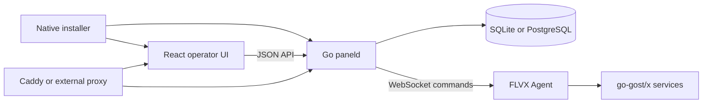
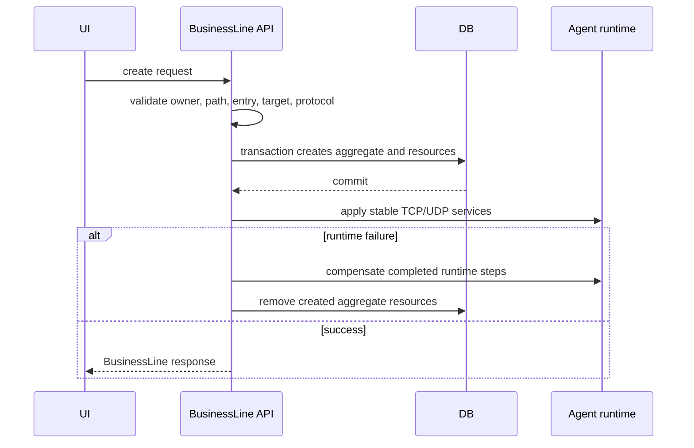
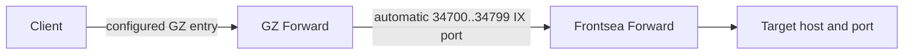
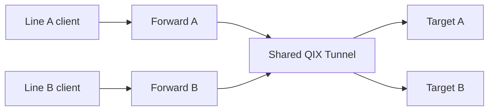
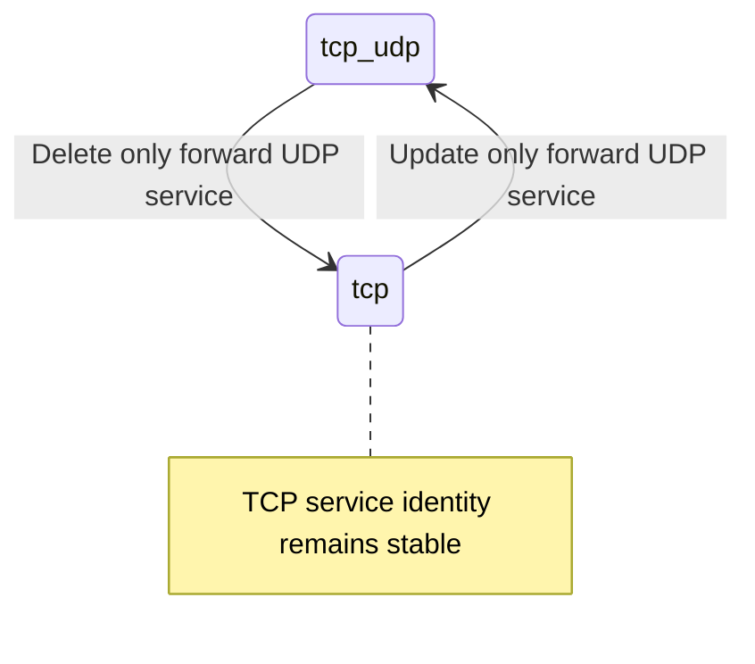

# FV-DX architecture diagrams

These diagrams summarize the implementation documented in
`docs/dx/architecture.md`. Source code remains authoritative.

## Components

## BusinessLine creation

## Frontsea Direct data path

Ports `34700..34725` are statically reserved. Allocation also excludes persisted
ForwardPort use and live bind conflicts. A partial two-hop apply is rolled back.

## QIX shared Tunnel data path

The Tunnel is infrastructure, not a child of either line. Deleting or switching
one line cannot delete, rebuild, or restart it.

## Protocol switch

Frontsea applies both Forward hops and compensates completed hops in reverse on
failure. QIX changes only the line's Forward. The database expected-state update
happens after runtime success; persistence failure triggers runtime rollback.
